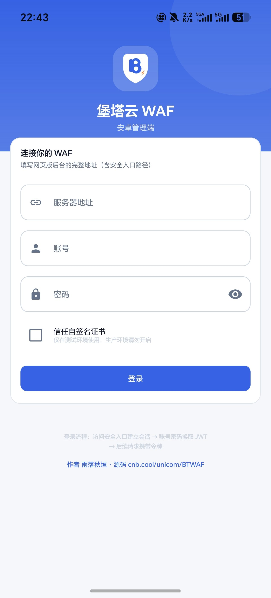
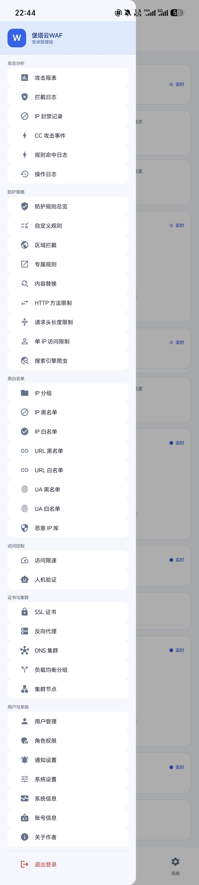

# 堡塔云 WAF 安卓管理端（BTWAF）

堡塔云WAF（[aaPanel/aawaf](https://github.com/aaPanel/aawaf)）的原生 Android 客户端，使用 Kotlin + Jetpack Compose 编写，
通过完整会话接口（后台 Cookie + JWT）而非有限的开放 API 接入，功能覆盖后台绝大部分模块。

- 源码仓库：<https://cnb.cool/unicom/BTWAF>
- 作者：雨落秋垣 · <https://uniomo.com>

## 界面

<p align="center">
  
  
</p>

<p align="center"><sub>左：登录页—— 服务器地址一律由使用者自行填写，App 不预填任何示例地址。<br>右：侧边抽屉导航，按「攻击分析 / 防护策略 / 黑白名单 / 访问控制 / 证书与集群 / 用户与系统」分组。</sub></p>

## 一、技术栈

| 项 | 版本 / 选型 |
|---|---|
| 语言 | Kotlin 1.9.24 |
| UI | Jetpack Compose（Material3）+ Navigation Compose |
| 网络 | Retrofit 2.11 + OkHttp 4.12 + Gson Converter |
| 存储 | SharedPreferences（连接信息与 JWT） |
| AGP / Gradle | 8.5.2 / 8.7 |
| compileSdk / minSdk | 34 / 24 |

## 二、鉴权流程（重要）

后台并非标准 REST API，直接 POST `user/login` 会被安全入口中间件拦下。正确顺序是：

```
1) GET  https://<host>:<port>/<入口路径>          # 建立 SID 会话 Cookie
2) POST https://<host>:<port>/api/user/login      # {username, password} -> res.token(JWT)
3) POST https://<host>:<port>/api/<module>/<action>
   Header: Authorization: bt<token>               # 前缀 "bt"，无空格
   Cookie: 步骤 1 得到的会话 Cookie
```

> **注意**：`/api/*` 挂在**站点根路径**下，不在入口路径之下。`/<入口路径>/api/...` 会 404。

统一响应包：`{ "code": 0, "res": <data>, "nonce": <ts> }`，`code == 0` 表示成功；失败时 `res` 通常是错误描述字符串。

## 三、界面与模块对应关系

| 界面 | 主要接口 |
|---|---|
| 登录 | `user/login`、`user/logout` |
| 概览 | `overview/count_info`、`overview/infos`、`overview/attack_map`、`sys/get_system_info` |
| 防护网站 | `wafmastersite/get_site_list`、`create_site`、`modify_site`、`delete_site`、`get_site_log`、`get_all_ssl` |
| 拦截记录 | `report/attack_report_log`、`report/attack_report_log_info`、`report/cc_list` |
| IP / URL / UA 黑白名单 | `limit/get_ip`、`get_url`、`get_ua`、`set_*`、`del_data`、`off_*` |
| 操作日志 | `opt_log/list` |
| 自定义规则 | `customize/list`、`customize/remove` |
| 访问控制 | `speed/get_list`、`speed/open_rule_status` |
| 人机验证 | `manm/get_list`、`manm/del_rules`、`manm/off_authtype` |
| 区域拦截 | `wafrules/get_regional_restrictions_rules`、`del_*`、`set_*` |
| 防护规则 | `wafrules/get_global_rules`、`apply_all`、`set_cc_rules`、`set_site_run_mode`、`set_malicious_ip`、`recover_default_config`、`update_spider_rules` |
| 通知 | `notification/list`、`notification/update`、`notification/clear`（邮箱 / 钉钉 / 飞书 / 企业微信） |
| 系统设置 | `config/get_config` 及 `set_title` / `set_domain` / `set_ip` / `set_language` / `set_timeout` / `set_port` / `set_admin_path` / `set_basic_auth` / `set_open_api` / `set_pwd` |
| 账号与运维 | `user/profile`、`user/update_profile`、`user/restart`、`user/update` |
| 在线更新 | 无（读仓库 commit 附件 `version.json`，比 `versionCode` 后按需下载 APK） |

接口全量清单（315 个，由源码结构体方法自动提取）见 [`docs/API.md`](docs/API.md)。

## 四、构建

依赖 JDK 17 与 Android SDK 34。若本机已装在 `~/.workbuddy/binaries/android/`，可直接用 wrapper 构建：

```bash
export JAVA_HOME=~/.workbuddy/binaries/android/jdk17tmp/jdk-17.0.20.1+1
export ANDROID_HOME=~/.workbuddy/binaries/android/sdk
./gradlew assembleDebug
```

产物：

- 调试包 `app/build/outputs/apk/debug/app-debug.apk`
- 正式包 `app/build/outputs/apk/release/app-release.apk`

### 签名

签名配置三级回退（优先级从高到低）：

| 优先级 | 来源 | 用途 |
|---|---|---|
| 1 | `keystore.properties`（本地文件，不入库） | 开发者自有证书 |
| 2 | 环境变量 `CI_KEYSTORE_*` | CNB 密钥库注入 |
| 3 | 仓库内 `keystore/release.jks` | **默认**：自签发布密钥 |

**为什么在线更新必须用同一个密钥**：Android 安装时会比对新旧包的签名，
不一致直接报 `INSTALL_FAILED_UPDATE_INCOMPATIBLE`，用户装不上升级包。
debug 密钥每台机器、每个构建容器都不同，所以 CI 与本地产物都统一用
release 签名，两者可以互相覆盖安装。

**关于仓库内置密钥**：本项目完全开源、安装包任何人可自行编译，签名密钥
在这里的作用不是"证明身份"，而是"证明这是同一个 App 的新版本"。
换成私有密钥的收益有限（谁都能自己编译），风险却很大
（密钥泄露或丢失 = 全量用户永久无法升级）。想换成自己的密钥，
在 CNB 仓库设置里配好 `CI_KEYSTORE_*` 即可，本地放一份
`keystore.properties`。

### 自动化构建与在线更新

**两条流水线，各管一类产物**，用途不同、都已实测通过：

| 触发 | 产物位置 | 用途 | 构建耗时 |
|---|---|---|---|
| push `main` | commit 附件 | App 在线更新的检查源 | 122~441 秒 |
| push tag（如 `v1.2.0`） | **Release** 附件 | 给用户手动下载的正式版 | 194 秒 |

#### 一、手动下载（Release）

打tag 即可自动生成 Release，无需手动传文件：

```bash
git tag -a v1.2.0 -m "堡塔云 WAF 安卓端 v1.2.0"
git push origin v1.2.0
```

流水线会依次执行 `create-release`（`type: git:release` 内置任务）
→ `build` → `upload-release-assets`。完成后：

- 页面入口：<https://cnb.cool/unicom/BTWAF/-/releases>
- 直链（匿名可下，**无需登录**）：

```
https://cnb.cool/unicom/BTWAF/-/releases/download/<tag>/btwaf-latest.apk
https://cnb.cool/unicom/BTWAF/-/releases/download/<tag>/version.json
```

> 路径必须是 `/-/releases/download/<tag>/<file>`。
> `/-/releases/<tag>/download/<file>` 会返回 **HTTP 200 +一张 HTML 页面**
> （`text/html`），下载下来是个打不开的网页，不是APK —— 判状态码会误判成成功。

#### 二、App 在线更新（commit 附件）

推送 `main` 后 [.cnb.yml](.cnb.yml) 自动构建 release APK，并把
**版本文件**与**安装包**一起上传为 commit 附件。App 靠它匿名查版本，
所以这一份**必须挂在 commit 上**（Release 附件要 tag 才有，而 tag 不常打）。

> ⚠️ **构建约需 2~8 分钟**（实测 122s 缓存命中 / 330~441s 冷构建）。
> 附件要等`upload-assets` 阶段结束才存在，所以 **push 之后的这 2~8 分钟里，
> 下面的下载地址一律返回 404**，而此时构建状态是 `pending` 而非 `error`——
> 很容易误判成「CI 坏了」。查真实状态要用已登录的 cnb CLI：
>
> ```bash
> cnb build get-build-logs  --repo unicom/BTWAF --page-size 5
> cnb build get-build-status --repo unicom/BTWAF --sn <构建号>
> ```
>
> `api.cnb.cool` 的构建接口用仓库 git PAT 是读不到的（返 `errcode:5`），
> 别在那上面反复试探。

附件挂在**某一次 commit** 上，`<ref>` 必须是完整 commit SHA，用分支名会 404：

```
https://cnb.cool/unicom/BTWAF/-/commit-assets/download/<commit_sha>/version.json
https://cnb.cool/unicom/BTWAF/-/commit-assets/download/<commit_sha>/btwaf-latest.apk
```

> 同一次构建的两份产物**字节不完全相同、sha256 也不同**——tag 流水线在独立
> 容器里重新构建，APK 内嵌构建时间戳。两者签名一致，都能覆盖安装，
> 这是正常现象，不是产物不一致的bug。

`version.json` 形如：

```json
{ "versionCode": 3, "versionName": "1.2.0", "apkName": "btwaf-latest.apk",
  "size": 12345678, "sha256": "…", "publishedAt": "2026-10-05T13:16:27Z" }
```

**版本号只有一处来源**：`app/build.gradle` 的 `versionCode` / `versionName`。
CI 用 sed 反查它生成 `version.json`，不要在手写文件里重复一遍 ——
两边一旦不一致，App 会永远提示"已是最新"，而 CI 全程绿灯。

App 端「系统 → 关于作者」页提供「在线更新」，分两次请求完成：

1. `GET https://cnb.cool/unicom/BTWAF.git/info/refs?service=git-upload-pack`
   —— Git smart HTTP 的引用发现端点，公开仓库免认证，取分支当前 commit 的 SHA
2. 用该 SHA 取 `version.json`，比对 `versionCode`

**只有确认 `versionCode` 确实更大才提示更新，APK 下载由用户点击触发**，
并支持断点续传与 SHA256 校验。两次请求合计只有几百字节，
流量消耗与实际更新次数成正比，而不是与打开 App 的次数成正比。

> 注意：`/-/raw/<ref>/<file>` 在文件不存在时返回 **HTTP 200 + 一张 HTML 错误页**，
> 只判状态码会把错误页当成版本文件，解析出 `versionCode = 0`，
> 表现为「永远提示已是最新」且毫无异常日志。App 端因此必须校验内容格式。

用 Android Studio 直接打开亦可，需在 `local.properties` 里写明 `sdk.dir`。

## 五、使用说明

1. 首次打开在登录页填入「服务器地址」，形如 `https://<你的IP>:<端口>/<入口路径>`（**含入口路径**）。
   地址一律由用户自行填写，App 不预填任何示例地址。
2. 若后台使用自签名证书，勾选「信任自签名证书」。
3. 登录成功后会话保存在本地，下次自动进入；退出登录会清除 token。

> 安全提示：「信任自签名证书」会跳过 TLS 校验，仅建议在测试环境开启。

## 六、已实现的非显然处

- **ListConfig 驱动**：IP/URL/UA 名单、操作日志、自定义规则、限速、人机验证、区域拦截共用一个屏幕和 ViewModel，
  由配置项描述列表路径、新增字段、删除参数形态（单值 / 数组）、开关动作（0/1 或 bool），避免重复代码。
- **开关字段兼容**：后端对开关状态混用布尔、数字、字符串三种写法，读取时统一判定。
- **站点 ID 容错**：不同版本列表返回里站点标识字段可能是 `site_id` / `id` / `name`，按顺序取值。
- **响应形态容错**：列表数据有的在 `res.list`、有的直接是顶层数组，均做兼容。
